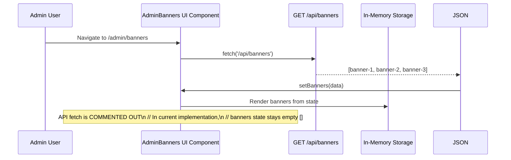
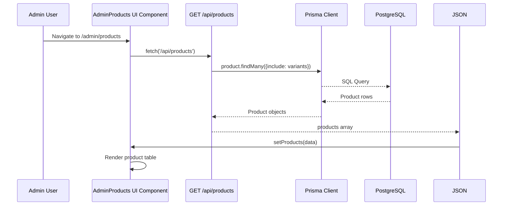

# System Architecture

## Architectural Pattern
The application follows a **Full-Stack Next.js 14 App Router** pattern with React 18. It uses a mixed data layer approach:
- **Products**: Prisma ORM backed by PostgreSQL
- **Banners**: In-memory JavaScript storage (no Prisma model)
- **Orders**: Prisma ORM with custom order service

## Component Diagram

```mermaid
graph TD
  %% Client-facing components
  UI[User Interface]
  App[Next.js App Router]
  Pages[Page Components]
  Admin[Admin Pages]

  %% API Routes
  BannersAPI[GET/POST/DELETE /api/banners]
  ProductsAPI[GET/POST /api/products]
  VariantsAPI[PATCH /api/admin/variants/[id]]
  OrdersAPI[GET/POST /api/orders]

  %% Database
  Prisma[(Prisma ORM)]
  DB[(PostgreSQL)]

  %% In-memory storage
  BannerStorage[In-Memory Banner Array]

  %% Styles
  classDef admin fill:#fef3c7,stroke:#f59e0b,stroke-width:2px;
  classDef api fill:#dbeafe,stroke:#3b82f6,stroke-width:2px;
  classDef db fill:#dcfce7,stroke:#10b981,stroke-width:2px;
  classDef storage fill:#fef3c7,stroke:#f97316,stroke-width:2px;

  class BannersAPI,ProductsAPI,VariantsAPI,OrdersAPI api
  class Prisma,DB db
  class BannerStorage storage
  class UI,Admin Pages UI
```

## API-Defined Interfaces

### Banner API Contracts
- **GET /api/banners** → `Array<{id: string, imageUrl: string, linkUrl: string, displayOrder: number, isActive: boolean}>`
- **POST /api/banners** → `201 {id: string, imageUrl: string, linkUrl: string, displayOrder: number, isActive: boolean}`
- **DELETE /api/banners** → `200 {success: boolean}`

### Product API Contracts
- **GET /api/products** → `Array<Product>` (with variants included)
- **POST /api/products** → `Product` (created with variants)

### Admin Variant Contract
- **PATCH /api/admin/variants/[id]** → `{id: number, inventory: number}`

### Order API Contract
- **POST /api/orders** → Order creation result
- **GET /api/orders** → `{info: string}`

## Interaction Diagrams

### Banner Data Flow (API → UI)



**Note**: The API returns banner data successfully, but the UI's `useEffect` hook that fetches from `/api/banners` is **completely commented out** (lines 28-36 of `src/app/admin/banners/page.tsx`). The banners state initializes as `[]` and never populates unless the fetch is re-enabled.

### Admin Navigation Flow

```mermaid
flowchart TD
    Admin[Admin User] -->|Clicks nav link| Dashboard
    Dashboard -->|/admin/products| ProductsPage
    Dashboard -->|/admin/orders| OrdersPage
    Dashboard -.->|Missing link: /admin/banners| BannersPage
    
    note Admin "Admin Dashboard:\n  • Manage Products\n  • View Orders\n  • [NO BANNERS LINK]\n\nBanners page exists at:\n  /admin/banners\n  but is not reachable\n  from main navigation"
```

**Issue**: The admin dashboard (`src/app/admin/page.tsx`) only has navigation links to Products and Orders. There is no link to the banners management page, making the feature invisible to admins navigating the dashboard.

### Product Data Flow (API → UI) - for comparison

